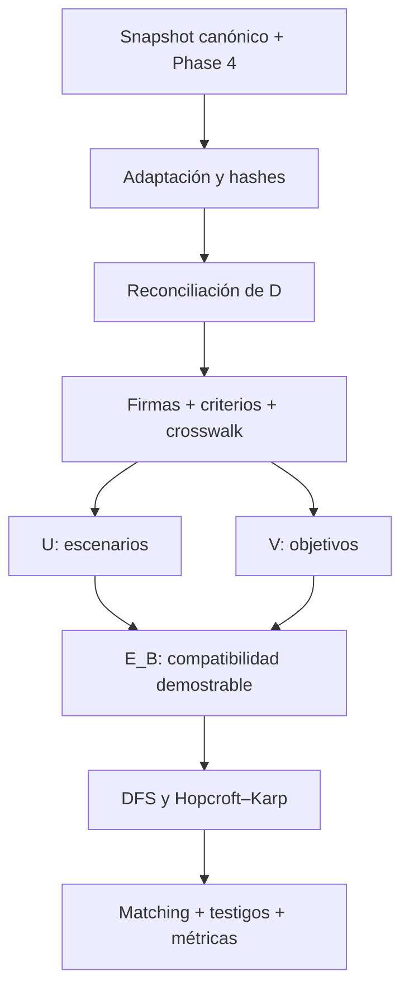

# Metodología

## Goal y pregunta computacional

**Goal:** construir, verificar y comunicar una aplicación reproducible de emparejamiento máximo bipartito que asigne escenarios simbólicos, distintos y trazables al mayor número posible de obligaciones de cobertura derivadas de la GPC `gpc-05-hipertension-embarazo-2025`.

La unidad de análisis no es una paciente. Es una entidad estructurada de prueba. La pregunta es:

> ¿Cuál es la máxima cardinalidad de una asignación uno-a-uno entre escenarios generados por reglas explícitas y obligaciones de cobertura respaldadas por la fuente?

El proyecto no estima efectos, riesgos o probabilidades; no diagnostica ni recomienda conductas; no mide desempeño clínico.

## Diseño general

Se usa un pipeline determinista con dos representaciones que no deben confundirse:

1. El grafo dirigido `D=(N,A)` conserva la topología del flujograma: decisiones, ramas, acciones, alcanzabilidad y nodos aislados.
2. El grafo bipartito `B=(U,V,E_B)` representa una relación de compatibilidad entre escenarios `U` y objetivos `V`.



Cada flecha es una transformación con contrato y gate. La salida de una etapa inválida no continúa.

## Jerarquía de evidencia

| Nivel | Fuente | Responsabilidad |
|---|---|---|
| 1 | `flowcharts.json`, `recommendations.json`, `tables.json`, `structure.json` | Autoridad primaria local para contenido y topología |
| 2 | Phase 4 filtrada por `source_id` exacto | Representación derivada para reconciliar IDs y conteos |
| 3 | Reglas versionadas del proyecto | Formalizar firmas, escenarios, objetivos y compatibilidad |
| 4 | CLRS, cap. 25 y artículos primarios | Sustentar teoría y complejidad algorítmica |
| 5 | Tests, oráculos y benchmarks | Evidencia de correctitud computacional y comportamiento local |

Una capa inferior no “corrige” silenciosamente a una superior. La fuente primaria decide la semántica local; Phase 4 no se ingiere como un segundo grafo clínico.

## Ingesta y control de fuente

La raíz autorizada debe contener el snapshot exacto y `outputs/phase4`. Ocho archivos obligatorios se verifican mediante SHA-256. Los adaptadores de Phase 4 filtran antes de adaptar:

```python
row.get("source_id") == "gpc-05-hipertension-embarazo-2025"
```

Esto excluye otras guías y la variante `gpc-05-hipertension-embarazo-resumida-2025`, cuyo mapa está en estado `draft`. También evita que el nombre `decision_graphs_filtered.jsonl` se tome como garantía de alcance.

Los conteos de control son 5 recomendaciones/BPC, 221 tablas, 3 flujogramas, 30 segmentos, 269 unidades y 3 grafos Phase 4. Una diferencia de hash o conteo activa `SOURCE_DRIFT`.

## Reconciliación del grafo dirigido

Para cada `flow_id` se comparan:

- conjunto de nodos y sus campos estructurales;
- multiconjunto normalizado de aristas `(origen,destino,etiqueta)`;
- página y sección;
- nodo de inicio;
- ausencia de `route_templates` materializados.

La reconciliación fue exacta: `flow_1` 6/5, `flow_2` 9/7 y `flow_3` 8/8 nodos/aristas. Los IDs locales se convierten en IDs compuestos (`flow_2:n4`) porque `n4` se repite entre flujos.

### Semántica controlada

- Las dos aristas `Sí` de `flow_1:n1` se modelan como activación `AND`, respaldada por la advertencia de la fuente.
- Las ramas `Sí/No` y `Con/Sin criterios` de `flow_2` son `XOR`.
- `flow_2:n9` se conserva como aislado informativo; no es terminal alcanzable ni origina una firma.
- `flow_3` es metodológico y se audita, pero no participa en `U`, `V` o `E_B`.

## Firmas de ejecución

Una firma es una plantilla alcanzable y versionada:

\[
\sigma=(G, O, P, A, R, S),
\]

donde `G` es el grafo, `O` resultados de decisión, `P` predicados, `A` acciones activadas, `R` nodos alcanzados y `S` semántica de rama. Se definieron cinco firmas respaldadas por los dos flujos incluidos: riesgo no alcanzado, riesgo con ramas paralelas, presión no elevada, presión elevada sin criterios y presión elevada con criterio.

## Construcción de `U`

Los escenarios son simbólicos y no contienen narrativas clínicas libres. Su cardinalidad se deriva de reglas versionadas:

| Regla | Construcción | Conteo |
|---|---|---:|
| `risk_high_single:v1` | un factor explícito de riesgo alto | 10 |
| `risk_moderate_pair_without_replacement:v1` | pares no ordenados de 11 factores moderados | `C(11,2)=55` |
| `explicit_low_risk_profile:v1` | perfil leve explícito | 1 |
| `flow_2_negative_branch:v1` | firma estructural negativa | 1 |
| `flow_2_no_severity:v1` | firma sin criterio de severidad | 1 |
| `one_explicit_severity_criterion:v1` | uno de siete criterios explícitos | 7 |
| **Total** |  | **75** |

No se usa muestreo aleatorio. Los pares moderados se generan sin reemplazo mediante combinaciones; por tanto, el resultado es reproducible y no duplica `(a,b)` como `(b,a)`.

## Construcción de `V`

Los objetivos se deduplican por identificador y concepto estructurado, no por similitud textual:

| Familia | Conteo |
|---|---:|
| factores de riesgo alto | 10 |
| factores de riesgo moderado | 11 |
| criterios de severidad | 7 |
| recomendaciones/BPC | 5 |
| resultados estructurales de decisión | 2 |
| **Total** | **35** |

El perfil de riesgo leve genera un escenario de rama negativa, pero no un objetivo factorial independiente. Esta asimetría está declarada y evita atribuir una obligación no definida.

## Crosswalk y compatibilidad

El crosswalk une conceptos mediante IDs explícitos de grafo, recomendación y criterio. No usa embeddings, similitud semántica ni conocimiento médico externo.

Para `u∈U` y `v∈V`:

\[
c(u,v)=I(R_v\subseteq P_u)
I(F_v\cap P_u=\varnothing)
I(A_v\subseteq A_u)
I(z_u=z_v=\text{validated})
I(g_u=g^*)I(\rho_{uv}=1).
\]

Se incluye `(u,v)` en `E_B` si y solo si `c(u,v)=1`. Cada decisión registra predicados satisfechos, faltantes, contradicciones, regla, versión, motivos de exclusión y fuentes. La recomendación `rec_3` carece de acción explícita reconciliable en los flujos; su crosswalk queda `human_review_required` y sus 75 pares posibles son rechazados.

La descomposición observable de aristas es:

\[
|E_B|=10+110+7+130+1+7+2=267.
\]

Los sumandos corresponden a alto riesgo, moderado, severidad, dos recomendaciones con 65 escenarios compatibles cada una, BPC sin severidad, BPC con severidad y dos objetivos estructurales.

## Problema de optimización

Con variable binaria `x_uv`:

\[
\max \sum_{(u,v)\in E_B}x_{uv},
\]

sujeto a:

\[
\sum_{v:(u,v)\in E_B}x_{uv}\le1\quad\forall u\in U,
\qquad
\sum_{u:(u,v)\in E_B}x_{uv}\le1\quad\forall v\in V.
\]

Esto es matching máximo no ponderado. No es *set cover*: un escenario compatible con varios objetivos solo puede representar uno dentro de `M`. Tampoco es propensity-score matching, matrimonio estable ni asignación ponderada.

## Algoritmos propios

### Baseline por camino aumentante

Se recorre cada vértice libre de `U` y se busca por DFS una secuencia alternante capaz de liberar un objetivo. Una reasignación exitosa aumenta `|M|` en uno. En el peor caso se realizan `|U|` búsquedas de costo `O(m)`, por lo que el tiempo es `O(|U|m)⊆O(nm)` y el espacio total `O(n+m)`.

### Hopcroft–Karp

Cada fase:

1. BFS asigna distancias a vértices libres de `U` y determina la longitud mínima de los caminos aumentantes disponibles.
2. DFS recorre únicamente aristas admisibles entre capas consecutivas.
3. Se aumenta un conjunto de caminos más cortos disjuntos en la misma fase.

CLRS demuestra `O(m√n)` bajo las condiciones del grafo activo. La implementación admite aislados explícitos, de modo que reporta `O(n+m√n)` como cota de ejecución completa y `O(n+m)` de espacio.

NetworkX no participa en el demo principal: solo aporta una cardinalidad de oráculo en pruebas y benchmarks.

## Certificados de objetivos no cubiertos

Un objetivo libre no se interpreta solo por su grado. Desde cada objetivo libre se explora el digrafo alternante: aristas no emparejadas de `V` hacia `U` y aristas emparejadas de `U` hacia `V`. El conjunto alcanzado produce un testigo de Hall `S⊆V`:

\[
\delta(S)=|S|-|N(S)|>0.
\]

Se observaron dos componentes deficitarios:

1. **Brecha de evidencia:** `S={rec_3}`, `|S|=1`, `|N(S)|=0`.
2. **Cuello de capacidad:** ocho objetivos —siete criterios de severidad y una BPC asociada— compiten por siete escenarios; `|S|=8`, `|N(S)|=7`.

Como los déficits suman 2, ningún matching puede superar `35-2=33`. La implementación construye un matching de tamaño 33; esta cota superior y la solución factible forman un certificado directo de optimalidad para el demo.

## Diseño de verificación

La verificación usa evidencia complementaria:

- casos unitarios conocidos y entradas inválidas;
- 689 grafos etiquetados exhaustivos con particiones de tamaño 0 a 3;
- enumeración exacta del óptimo en cada grafo pequeño;
- concordancia de cardinalidad entre DFS, Hopcroft–Karp y NetworkX;
- invariantes de unicidad y pertenencia de aristas;
- tests de procedencia y de aislamiento de dominio;
- reconciliación exacta del snapshot;
- repetición determinista del pipeline;
- testigos de Hall para déficits observados.

No se exige que los tres métodos devuelvan los mismos pares, porque pueden existir múltiples matchings máximos.

## Protocolo experimental

Los tiempos son microbenchmarks descriptivos de pared:

- una ejecución de calentamiento;
- 21 repeticiones;
- mediana y cuartiles inclusivos;
- fixtures sin aleatoriedad;
- pico aproximado de asignaciones Python con `tracemalloc` en una ejecución separada;
- cardinalidad verificada con NetworkX.

Se separan el grafo GPC y dos familias matemáticas. No se realizan pruebas de hipótesis sobre tiempos: las repeticiones no son muestras independientes de una población científica y el objetivo es ingeniería reproducible, no inferencia de hardware.

## LOOP de desarrollo y gates

El trabajo sigue:

```text
INSPECT → PLAN → IMPLEMENT → VERIFY → EVIDENCE AUDIT → REVIEW → RECORD
                           ↑                              |
                           └──────── siguiente corte ────┘
```

Cada vuelta debe acercar el estado al Goal y cerrar un corte vertical. Un gate fallido bloquea el registro final: estructura, reconciliación, semántica, algoritmo, fuente, dominio, trazabilidad, responsabilidad, experimento, currículo, documentación o entrega.

## Reproducibilidad

Los resultados se regeneran con:

```bash
export BIPARTITE_MINSA_SOURCE_ROOT=/ruta/a/integration_design_data
python scripts/validate_sources.py --source-root "$BIPARTITE_MINSA_SOURCE_ROOT"
python -m bipartite_minsa.pipeline.run_matching \
  --source-root "$BIPARTITE_MINSA_SOURCE_ROOT" \
  --output-dir reports/runtime
python scripts/run_benchmarks.py \
  --source-root "$BIPARTITE_MINSA_SOURCE_ROOT" \
  --output reports/benchmarks.json --repeats 21
python scripts/validate_project.py --source-root "$BIPARTITE_MINSA_SOURCE_ROOT"
```

La fuente no se versiona. El manifiesto, hashes, reglas, código, pruebas y resultados agregados sí permiten detectar drift y reconstruir la transformación.
